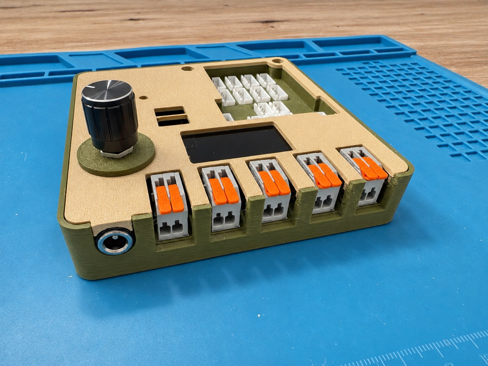
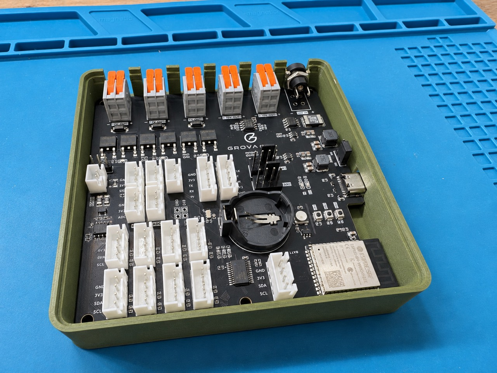

# GROVA Core Firmware

Local-first firmware for the GROVA Core environmental controller. Configure physical
ports, connect sensors and run manual, scheduled or sensor-driven automation from
the controller's own web interface.



*Current hardware prototype. Photos supplied by the project owner; display and
encoder acceptance remain open.*

## Current status

The active hardware platform is the **ESP32-S3-WROOM-1-N16R8** with 16 MB flash
and 8 MB PSRAM. The S3 application has been installed and checked on real hardware.
As of **16 November 2026**, the recorded installed release is
`founder-dev.20261116.1` (source `4c04eaf`). This repository cleanup does not install
a new release. See [software validation](docs/software-validation.md) and the
[hardware bring-up record](docs/board-bringup.md) for evidence and limitations.

**Hardware acceptance is still in progress.** Sensor disconnection/recovery,
long-term RTC operation, electrical outputs, PWM/tachometer, 0–10 V and pump/load
tests remain open. Display and encoder work is deferred. The legacy V1 firmware
remains available as a frozen reference; it is a separate hardware target.

## Hardware reference

The current controller PCB in its enclosure:



*Assembly state shown in the supplied photo; photographs do not replace electrical
or functional acceptance. [Top view](docs/hardware/core-s3/photos/core-s3-top.jpg).*

[S3 pinout and hardware notes](docs/hardware/core-s3/README.md) ·
[Schematic, 1 November 2026 (PDF)](docs/hardware/core-s3/SCH_Schematic1_2026-11-01.pdf)

## Capabilities

- Local Wi-Fi setup and browser interface; application OTA updates.
- Fixed-voltage physical ports with compatible device profiles.
- Independent manual, scheduled and sensor-driven control.
- Multiple daily windows/intervals, percentage control where supported, and flexible fan roles.
- Explicit sensor source binding, hysteresis, delays, limit actions and fallback.
- Persistent pause and configuration; bounded watering pulses with restart journals.
- Rule diagnostics, warnings, event export, RAM measurement history and device backup/restore.

Available connectors do not imply an implemented or physically validated driver.
See [architecture](docs/architecture.md), [equipment](docs/equipment.md),
[automation](docs/automation.md) and [command safety](docs/command-safety.md).

## Build

Install PlatformIO Core and run from the repository root:

```sh
pio run -e grova_founder_s3
```

| Target | Purpose |
| --- | --- |
| `grova_founder_s3` | Current integrated ESP32-S3 application; default build |
| `grova_founder_s3_bringup` | Isolated S3 hardware diagnostic firmware |
| `grova_core_v1` | Frozen legacy ESP32 application |

The existing build names, preprocessor switches, namespaces and persisted identifiers
are retained for compatibility. File and directory names use neutral product/function
names. Building does not upload firmware. Device updates require a separate explicit
operation after checking board identity and preserving the current configuration.

Local credentials and board overrides are ignored by Git. Never commit passwords.
See [firmware profiles](docs/firmware-profiles.md) and [Wi-Fi setup](docs/wifi-setup.md).

## Repository layout

| Path | Contents |
| --- | --- |
| `src/controller/` | Current S3 application, devices, automation and embedded web interface |
| `src/bringup/` | Isolated hardware diagnostic application |
| `src/modules/` | Shared services and legacy V1 modules |
| `include/boards/` | Hardware pin profiles |
| `docs/` | Firmware contracts, hardware references and validation records |
| `tests/controller/` | Hardware-free controller, policy and web tests |
| `tests/host/` | Shared/legacy lifecycle and Wi-Fi host tests, including common test adapters |
| `tests/embedded/` | PlatformIO board tests; hardware execution requires a prepared bench |
| `tools/` | Local web preview and first-flash packaging tools |

This repository contains firmware and its supporting engineering assets. Dashboards,
servers, marketing sites and internal project coordination belong outside this repository.
Generated builds (`.pio/`) and first-flash packages (`dist/`) are not source artifacts.

## Tests

```sh
python tests/controller/run_tests.py
python tests/host/run_tests.py
python tests/controller/check_web.py
```

Host tests require a C++17 compiler; web syntax checks require Node.js. Controller
tests also use the ArduinoJson headers installed by the S3 build. For Zig, pass
`--compiler /path/to/zig --zig`. Browser acceptance scripts and the embedded test
procedure are explained in [tests/README.md](tests/README.md).

CI compiles all three firmware targets, compiles the embedded pump tests without
uploading or executing them, runs the host suites and checks embedded JavaScript.
Automated checks complement physical acceptance; they do not establish water flow,
electrical levels or correct load behavior.

## Documentation

- [Documentation index](docs/README.md)
- [Architecture](docs/architecture.md) and [API](docs/api.md)
- [Hardware and bring-up](docs/board-bringup.md)
- [Software validation](docs/software-validation.md)
- [Legacy V1 freeze](docs/v1-freeze.md)
- [License](LICENSE) and [change log](CHANGELOG.md)
